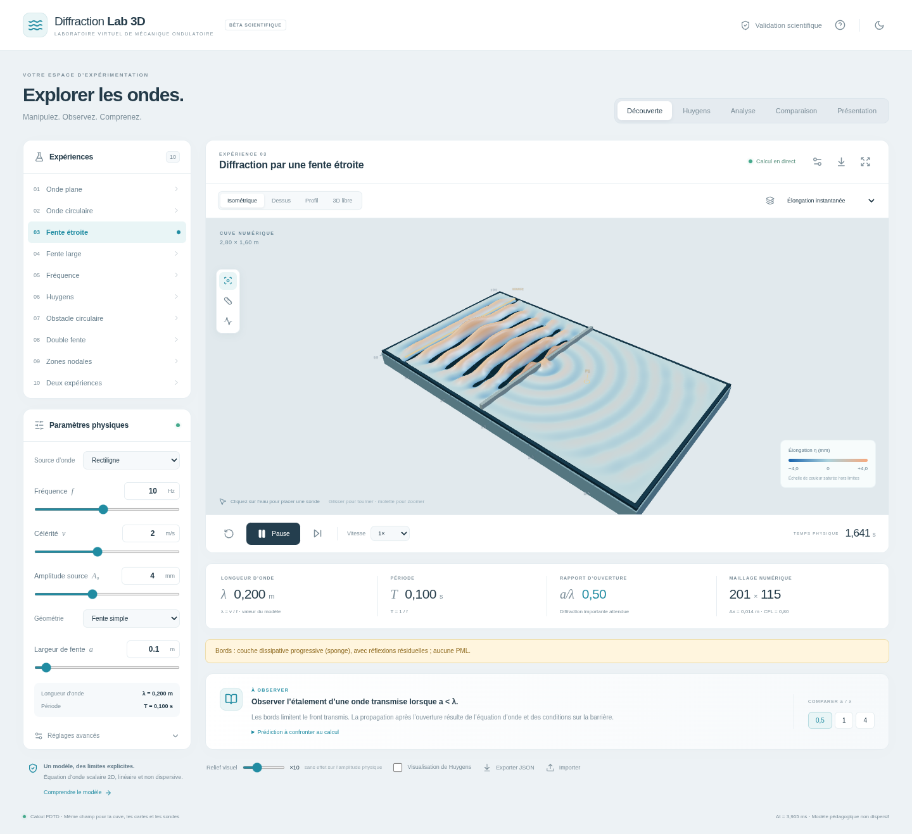

# Diffraction Lab 3D

Laboratoire de mécanique ondulatoire en français : une équation d’onde calculée sur une grille 2D, affichée sous forme de cuve 3D. Projet pédagogique pour la deuxième année du Baccalauréat Sciences Mathématiques.

**[Ouvrir le laboratoire en ligne](https://adammouatacime1.github.io/diffraction-lab-3d/)** — accessible directement dans le navigateur, sans installation. Le site est publié avec GitHub Pages depuis la branche `gh-pages`.

Le modèle est **scalaire, linéaire et non dispersif**. Il permet d’étudier propagation, diffraction, réflexion et interférences ; il ne simule pas toute la physique des vagues réelles. La vue 3D, les cartes et les sondes utilisent le même champ numérique.

## Aperçu du laboratoire

Capture réelle de l’application, obtenue pendant la vérification dans Chromium :



## Vidéo pour le professeur

La visite guidée dure environ **10 min 21 s**. Elle montre 22 chapitres de manipulations réelles, avec une **voix de synthèse neuronale française Kokoro**, des sous-titres incrustés et des repères de chapitre.

- [Télécharger la vidéo MP4](https://raw.githubusercontent.com/adammouatacime1/diffraction-lab-3d/livraison-diffraction-lab-3d/docs/video/presentation-professeur.mp4)
- [Écouter un aperçu de la voix de synthèse (9 secondes)](https://raw.githubusercontent.com/adammouatacime1/diffraction-lab-3d/livraison-diffraction-lab-3d/docs/video/extrait-voix-francaise.mp3)
- [Consulter le déroulé et le commentaire français](docs/VIDEO-PROFESSEUR.md)
- [Accéder aux fichiers vidéo, sous-titres et contrôles](docs/video/)

Le MP4 se lit avec le lecteur vidéo de Windows ou VLC, sans lancer l’application. Les résultats montrés sur la page de validation ont été calculés pendant le tournage.

## Ouvrir l’application

Installez [Node.js](https://nodejs.org/) (version 22 LTS recommandée), puis ouvrez un terminal dans le dossier du projet :

```sh
npm install
npm run dev
```

Ouvrez l’adresse affichée par Vite. Dans un environnement cloud, utilisez l’aperçu ou le transfert du port **5173**. Gardez le terminal ouvert pendant l’utilisation ; `Ctrl+C` arrête le serveur.

Une fois le fichier de verrouillage présent, `npm ci` permet une réinstallation reproductible des versions enregistrées. Aucune clé d’API ni base de données n’est nécessaire.

## Première démonstration

1. Choisissez **Onde plane**, puis la vue du dessus. Pour `v = 2 m/s` et `f = 10 Hz`, lisez `λ = 0,20 m` et `T = 0,10 s`.
2. Comparez **Fente étroite** (`a/λ = 0,5`) et **Fente large** (`a/λ = 4`). Recommencez chaque expérience depuis les mêmes conditions initiales.
3. Ouvrez **Huygens** : les points et cercles sont une illustration pédagogique ; le champ calculé reste indépendant de cette illustration.
4. Passez à **Analyse**, avec la double fente ou deux sources, et comparez élongation instantanée et amplitude locale.
5. Consultez **Validation scientifique**, puis utilisez **Présentation** pour projeter la cuve et ses paramètres.

Le [guide d’utilisation](docs/GUIDE.md) propose un déroulé de cinq minutes. Le document [Modèle et méthode numérique](docs/MODELE.md) explique les équations, les mesures et les limites.

L’analyse comprend deux sondes, leurs courbes, un temps d’arrivée défini par un seuil, une règle, une coupe et un profil angulaire mesuré dans le champ calculé. La comparaison côte à côte fait principalement varier la largeur de fente ; les autres paramètres sont communs. Les captures PNG contiennent les paramètres, qui peuvent aussi être exportés et importés en JSON.

## Vérifier et compiler

```sh
npm test
npm run build
npm run preview
```

`npm test` exécute les tests automatisés ; `npm run build` vérifie TypeScript et crée le dossier `dist`. La commande `preview` sert localement cette compilation. Les résultats affichés par **Validation scientifique** sont calculés par le programme ; ce document ne leur attribue pas un succès à l’avance.

Le script `npm run test:browser` est un contrôle de navigateur complémentaire. Il requiert un navigateur Chromium compatible et un serveur de développement, selon les indications du script. Il reste distinct des tests du solveur et ne suffit pas à valider scientifiquement une simulation.

## Organisation

- `src/physics/` : solveur et vérifications scientifiques.
- `src/components/` : cuve, outils, graphiques et aide.
- `src/data/experiments.ts` : dix expériences avec objectifs et prédictions.
- `src/types.ts` : paramètres et unités du modèle.
- `docs/` : guide français et justification numérique.

## Limites à annoncer au professeur

L’eau réelle peut être dispersive et visqueuse ; ce modèle ne comporte pas de mode gravito-capillaire. Les contours rigides sont approchés par des cellules. Les bords absorbants utilisent une couche amortissante, sans absorption parfaite. Une grille trop grossière introduit des erreurs de propagation et de géométrie.

L’amplitude et la phase sont des estimations harmoniques sur la dernière période, surtout pertinentes en régime établi. Une faible valeur sous un seuil ne démontre pas une amplitude exactement nulle. Le relief exagéré à l’écran ne change aucune grandeur physique. Le profil angulaire numérique est une mesure locale et ne garantit pas le champ lointain. La théorie de Fraunhofer est présentée séparément, sans imposer de formule au solveur.

## Préparer l’intégration GitHub

Les fichiers de l’application sont dans ce dépôt. Pour les intégrer, créez une branche de travail, examinez les changements et ouvrez une demande de fusion vers `main`. Incluez `package-lock.json` pour conserver les versions vérifiées. Les dossiers `node_modules`, `dist` et `test-results` sont générés et ignorés par Git.

Le dossier `dist`, produit par `npm run build`, peut être publié chez un hébergeur de sites statiques. Une publication de l’environnement cloud conserve les outils et les fichiers ; elle ne constitue pas une mise en ligne publique de l’application.

## Mettre le laboratoire en ligne

Pour obtenir une adresse partageable avec le professeur, suivez le [guide de mise en ligne](docs/MISE-EN-LIGNE.md). Une [archive du site déjà compilé](https://raw.githubusercontent.com/adammouatacime1/diffraction-lab-3d/livraison-diffraction-lab-3d/docs/site/diffraction-lab-website.zip) permet de publier le laboratoire avec Netlify Drop, sans installer Node.js sur votre ordinateur.
