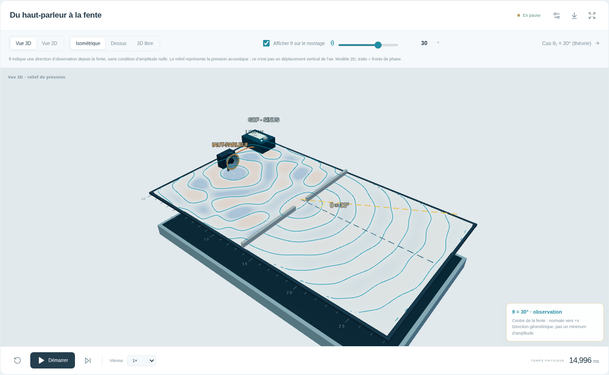

# Montage sonore en 3D et θ : captures et contrôles

Contrôles du **22 octobre 2026** sur la construction de production. Les captures sont produites dans Chromium, sans retouche. Le [guide 3D et θ](../GBF-3D.md) explique les commandes et les limites du modèle.

- [Rapport : 12 contrôles de navigateur réussis](browser-report.json), sans erreur JavaScript, console ou HTTP.
- [Empreintes de la construction et résultat des 74 tests unitaires](tested-build.json).
- [Régression de θ dans le milieu eau : 9 contrôles réussis](water-theta-browser-report.json).
- [Montage GBF en 2D : 8 contrôles réussis](gbf-2d-browser-report.json), avec activation/extinction et réglages physiques conservés.
- [Ordinateur : montage 3D avec θ](gbf-theta3d-desktop-light.png).
- [Ordinateur : caméra de dessus](gbf-theta3d-desktop-top.png).
- [Mobile : thème clair](gbf-theta3d-mobile-light.png) et [thème sombre](gbf-theta3d-mobile-dark.png).
- [Premier minimum théorique : cas séparé à 30°](gbf-theta3d-theoretical-minimum.png).
- [Repli Canvas 2D sans WebGL](gbf-theta3d-no-webgl.png).

Le contrôle vérifie la progression des fronts réellement dessinés en aval de la fente, le changement de θ et de caméra sans remise à zéro, ainsi que les exports PNG issus du canvas visible. La rotation par glisser à la souris et les gestes tactiles via CDP sont exercés en 3D libre ; le retour à la vue isométrique rétablit le défilement de la page. Les vues 2D et 3D partagent le même moteur. Les images mobiles utilisent une fenêtre Chromium de 390 px, sans appareil physique.

Le montage initial utilise un haut-parleur localisé ; θ y est une **direction d'observation**. Le premier minimum idéal de Fraunhofer est proposé dans un autre cas, avec une source plane et `a/λ = 2`. Le relief représente la pression d'un modèle acoustique 2D, sans calcul volumique de l'air.
