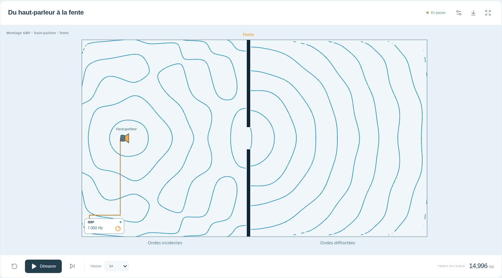

# Captures et rapports du montage GBF

Contrôles du **22 octobre 2026**. Les captures sont produites par Chromium sur l'application, sans retouche. Voir le [bilan de vérification](../GBF-VALIDATION.md) et le [guide du montage](../GBF.md).

## Voir le montage

- [Ordinateur : scène](gbf-desktop-scene.png) et [page complète](gbf-desktop-light.png).
- [Mobile clair : scène](gbf-mobile-scene-light.png) et [page complète](gbf-mobile-light.png).
- [Mobile sombre : scène](gbf-mobile-scene-dark.png) et [page complète](gbf-mobile-dark.png).
- [Montage 3D isométrique](gbf-3d-iso.png) et [vue de dessus](gbf-3d-top.png), accessibles dans les outils.

## Rapports

- [Montage GBF : 8 contrôles](gbf-browser-report.json).
- [Scène 3D finale : 3 contrôles](3d-browser-report.json).
- [Laboratoire eau : 18 contrôles](water-browser-report.json).
- [Angle θ : 9 contrôles](theta-browser-report.json).
- [Acoustique complète : 17 contrôles](acoustic-browser-report.json).
- [Construction finale : empreintes SHA-256 et conditions des contrôles](tested-build.json).

La vue d'observation montre des fronts issus de la pression calculée, avec un émetteur localisé en amont de la fente. Le dessin du GBF représente la commande électrique ; le circuit et la directivité réelle du haut-parleur ne sont pas simulés.
