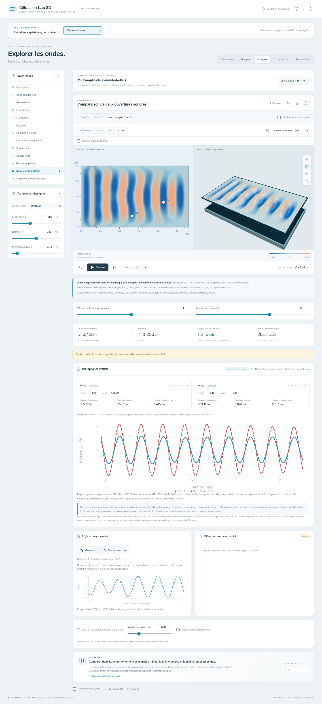

# Rapports et captures de référence

Ces fichiers proviennent des contrôles du **22 octobre 2026**, effectués sur le laboratoire existant enrichi du mode sonore. Les captures sont des images de navigateur, sans retouche. Les conditions, les commandes et les limites sont détaillées dans [VALIDATION-SON.md](../VALIDATION-SON.md).

## Rapports

- [Acoustique : 17 contrôles de navigateur](acoustic-browser-report.json), avec métadonnées des captures et vérification des temps effectivement dessinés.
- [Eau : 18 contrôles de navigateur](water-browser-report.json).
- [Angle θ : 9 contrôles de navigateur](theta-browser-report.json).
- [Cycle de vie : 12 assertions](lifecycle-report.json).
- [Empreintes SHA-256 de la construction testée](tested-build.json), avec branche source, point de départ et résultat des 71 tests unitaires.

## Captures

| Affichage | Clair | Sombre |
| --- | --- | --- |
| Ordinateur, largeur 1 440 px | [Voir](sound-1440-light.png) | [Voir](sound-1440-dark.png) |
| Mobile, largeur 390 px | [Voir](sound-390-light.png) | [Voir](sound-390-dark.png) |

- [Analyse et microphones sur ordinateur](sound-desktop-analysis-light.png).
- [Vues 2D + 3D sur ordinateur](sound-desktop-split-light.png).
- [Vues 2D + 3D sur mobile](sound-mobile-split-dark.png).
- [Comparaison de deux configurations, quatre vues sur mobile](sound-mobile-comparison-split-dark.png).
- [Carte 2D sans WebGL](sound-no-webgl.png).

